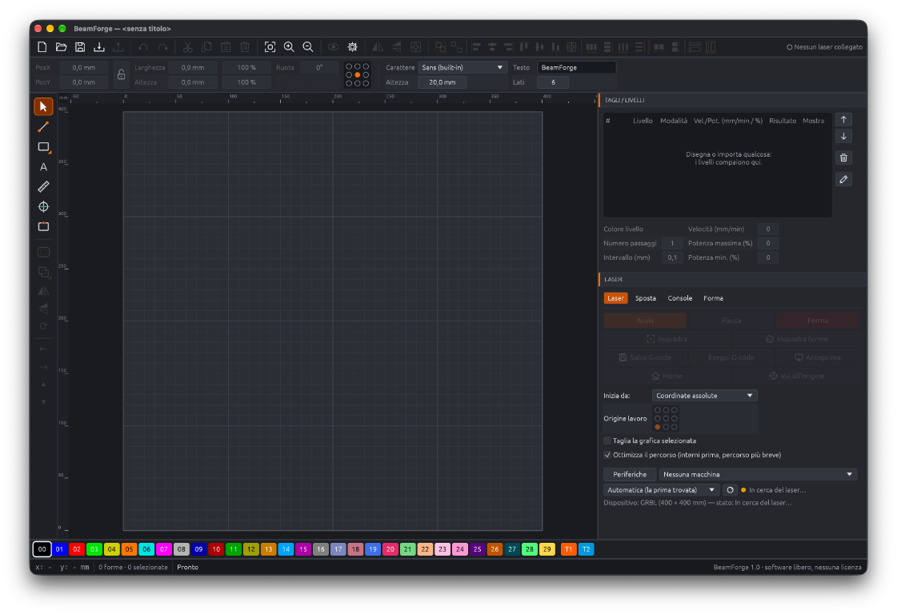

# BeamForge

  
   
  <em>BeamForge workspace: drawing canvas, layer palette, cutting settings, and laser controls.</em>

**Beta**

[English](#english) · [Italiano](#italiano) · [Español](#español) · [Français](#français) · [Deutsch](#deutsch)

---

## English

BeamForge is a desktop application for laser cutting and engraving, with a workflow similar to LightBurn: design, organize layers, configure processing parameters, preview the job, and send it to a compatible laser.

Developed in **Rust**.

### Features

- **Drawing and editing:** vector shapes, text, resizing, rotation, mirroring, alignment, distribution, grouping, and undo/redo.
- **Shape tools:** combine shapes, create offset contours, and measure distances.
- **Layer-based processing:** 30 processing layers and two non-output tool layers, with speed, power, passes, and scan interval settings.
- **Cutting and engraving:** Line, Fill, Offset Fill, and Image modes; threshold, dithering, and grayscale image processing.
- **File import:** SVG, DXF, common bitmap formats, and additional vector, project, 3D, and PCB formats, with varying levels of support.
- **Projects and export:** save and reopen `.beamforge` projects; export SVG and G-code.
- **Job preview:** animated toolpaths, travel moves, power shading, and estimated processing times.
- **Laser control:** serial connection to GRBL, GRBL-M3, and grblHAL controllers; device discovery, manual configuration, jogging, framing, and job start, pause, and stop.
- **Calibration tools:** material test grids and scan interval tests.
- **Languages:** English, Italian, Spanish, French, and German.

### Typical workflow

1. Create a design with the drawing tools or import an existing file.
2. Organize shapes into layers and set the cutting or engraving parameters for each layer.
3. Preview the toolpaths and estimated job time; then connect a compatible laser to frame or run the job.

### Beta status and compatibility

BeamForge is in beta. Features may change, bugs may occur, and file import may not preserve every element or setting. Full compatibility with LightBurn projects, features, or hardware is not guaranteed. Processing times are estimates.

### Safety

Always check the preview, work area, speed, and power before running a job. Use suitable eye protection and ventilation, follow your machine's safety instructions, and never leave an operating laser unattended.

LightBurn is a trademark of its respective owner. BeamForge is not affiliated with or endorsed by LightBurn.

### License

Copyright 2026 servimmagine. BeamForge is licensed under the [Apache License 2.0](LICENSE); see also [NOTICE](NOTICE). Third-party components remain subject to their respective licenses.

---

## Italiano

BeamForge è un'applicazione desktop per il taglio e l'incisione laser, con un flusso di lavoro simile a LightBurn: disegnare, organizzare i livelli, impostare i parametri di lavorazione, visualizzare l'anteprima e inviare il lavoro a un laser compatibile.

Sviluppata in **Rust**.

### Funzionalità

- **Disegno e modifica:** forme vettoriali, testo, ridimensionamento, rotazione, specchiatura, allineamento, distribuzione, raggruppamento e annulla/ripeti.
- **Strumenti per le forme:** combinazione di forme, creazione di contorni offset e misurazione delle distanze.
- **Lavorazione per livelli:** 30 livelli di lavorazione e due livelli strumento esclusi dall'output, con impostazioni di velocità, potenza, passate e intervallo di scansione.
- **Taglio e incisione:** modalità Linea, Riempimento, Riempimento offset e Immagine; elaborazione delle immagini a soglia, con dithering e in scala di grigi.
- **Importazione:** SVG, DXF, formati immagine comuni e ulteriori formati vettoriali, di progetto, 3D e PCB, con livelli di supporto variabili.
- **Progetti ed esportazione:** salvataggio e riapertura di progetti `.beamforge`; esportazione SVG e G-code.
- **Anteprima del lavoro:** percorsi animati, spostamenti a vuoto, visualizzazione della potenza e stima dei tempi di lavorazione.
- **Controllo laser:** collegamento seriale a controller GRBL, GRBL-M3 e grblHAL; ricerca delle periferiche, configurazione manuale, spostamenti manuali, inquadratura e avvio, pausa e arresto del lavoro.
- **Strumenti di calibrazione:** griglie di test dei materiali e test dell'intervallo di scansione.
- **Lingue:** inglese, italiano, spagnolo, francese e tedesco.

### Flusso di lavoro tipico

1. Crea un disegno con gli strumenti grafici oppure importa un file esistente.
2. Organizza le forme nei livelli e imposta i parametri di taglio o incisione per ciascun livello.
3. Controlla i percorsi e la stima dei tempi nell'anteprima; poi collega un laser compatibile per inquadrare o avviare il lavoro.

### Stato beta e compatibilità

BeamForge è in fase beta. Le funzionalità possono cambiare, possono verificarsi errori e l'importazione potrebbe non conservare tutti gli elementi o le impostazioni. Non è garantita la piena compatibilità con i progetti, le funzionalità o l'hardware supportati da LightBurn. I tempi di lavorazione sono indicativi.

### Sicurezza

Controllare sempre anteprima, area di lavoro, velocità e potenza prima di avviare un lavoro. Utilizzare protezioni oculari e ventilazione adeguate, seguire le istruzioni di sicurezza della macchina e non lasciare mai il laser in funzione incustodito.

LightBurn è un marchio del rispettivo titolare. BeamForge non è affiliato a LightBurn né approvato da quest'ultimo.

### Licenza

Copyright 2026 servimmagine. BeamForge è distribuito con la [licenza Apache 2.0](LICENSE); vedere anche [NOTICE](NOTICE). I componenti di terze parti restano soggetti alle rispettive licenze.

---

## Español

BeamForge es una aplicación de escritorio para corte y grabado láser, con un flujo de trabajo similar al de LightBurn: diseñar, organizar capas, configurar los parámetros de procesamiento, previsualizar el trabajo y enviarlo a un láser compatible.

Desarrollada en **Rust**.

### Funciones

- **Diseño y edición:** formas vectoriales, texto, cambio de tamaño, rotación, reflejo, alineación, distribución, agrupación y deshacer/rehacer.
- **Herramientas de formas:** combinar formas, crear contornos desplazados y medir distancias.
- **Procesamiento por capas:** 30 capas de procesamiento y dos capas de herramientas excluidas de la salida, con ajustes de velocidad, potencia, pasadas e intervalo de barrido.
- **Corte y grabado:** modos Línea, Relleno, Relleno con desplazamiento e Imagen; procesamiento de imágenes por umbral, tramado y escala de grises.
- **Importación:** SVG, DXF, formatos de imagen habituales y otros formatos vectoriales, de proyecto, 3D y PCB, con distintos niveles de compatibilidad.
- **Proyectos y exportación:** guardar y abrir proyectos `.beamforge`; exportar SVG y G-code.
- **Vista previa:** trayectorias animadas, desplazamientos sin grabado, visualización de la potencia y estimación de los tiempos de procesamiento.
- **Control del láser:** conexión serie con controladores GRBL, GRBL-M3 y grblHAL; búsqueda de dispositivos, configuración manual, movimientos manuales, encuadre e inicio, pausa y detención del trabajo.
- **Herramientas de calibración:** cuadrículas de prueba de materiales y pruebas del intervalo de barrido.
- **Idiomas:** inglés, italiano, español, francés y alemán.

### Flujo de trabajo habitual

1. Crea un diseño con las herramientas de dibujo o importa un archivo existente.
2. Organiza las formas en capas y configura los parámetros de corte o grabado de cada capa.
3. Revisa las trayectorias y el tiempo estimado en la vista previa; después, conecta un láser compatible para encuadrar o ejecutar el trabajo.

### Estado beta y compatibilidad

BeamForge está en fase beta. Las funciones pueden cambiar, pueden producirse errores y la importación puede no conservar todos los elementos o ajustes. No se garantiza la compatibilidad completa con los proyectos, las funciones o el hardware admitidos por LightBurn. Los tiempos de procesamiento son estimaciones.

### Seguridad

Comprueba siempre la vista previa, el área de trabajo, la velocidad y la potencia antes de iniciar un trabajo. Utiliza protección ocular y ventilación adecuadas, sigue las instrucciones de seguridad de la máquina y nunca dejes un láser en funcionamiento sin supervisión.

LightBurn es una marca de su respectivo titular. BeamForge no está afiliado a LightBurn ni cuenta con su aprobación.

### Licencia

Copyright 2026 servimmagine. BeamForge se distribuye bajo la [licencia Apache 2.0](LICENSE); consulta también [NOTICE](NOTICE). Los componentes de terceros siguen sujetos a sus respectivas licencias.

---

## Français

BeamForge est une application de bureau pour la découpe et la gravure laser, avec un flux de travail similaire à celui de LightBurn : dessiner, organiser les calques, définir les paramètres d'usinage, prévisualiser le travail et l'envoyer à un laser compatible.

Développée en **Rust**.

### Fonctionnalités

- **Dessin et édition :** formes vectorielles, texte, redimensionnement, rotation, symétrie, alignement, répartition, groupement et annuler/rétablir.
- **Outils de formes :** combinaison de formes, création de contours décalés et mesure des distances.
- **Traitement par calques :** 30 calques de traitement et deux calques d'outils exclus de la sortie, avec réglage de la vitesse, de la puissance, des passes et de l'intervalle de balayage.
- **Découpe et gravure :** modes Ligne, Remplissage, Remplissage décalé et Image ; traitement des images par seuillage, tramage et niveaux de gris.
- **Importation :** SVG, DXF, formats d'image courants et autres formats vectoriels, de projet, 3D et PCB, avec des niveaux de prise en charge variables.
- **Projets et exportation :** enregistrement et ouverture des projets `.beamforge` ; exportation SVG et G-code.
- **Aperçu du travail :** parcours animés, déplacements sans gravure, visualisation de la puissance et estimation des temps de traitement.
- **Commande du laser :** connexion série aux contrôleurs GRBL, GRBL-M3 et grblHAL ; détection des périphériques, configuration manuelle, déplacements manuels, cadrage, démarrage, pause et arrêt du travail.
- **Outils de calibrage :** grilles de test des matériaux et tests de l'intervalle de balayage.
- **Langues :** anglais, italien, espagnol, français et allemand.

### Flux de travail type

1. Créez un dessin avec les outils de dessin ou importez un fichier existant.
2. Organisez les formes en calques et définissez les paramètres de découpe ou de gravure de chaque calque.
3. Vérifiez les parcours et la durée estimée dans l'aperçu, puis connectez un laser compatible pour cadrer ou lancer le travail.

### Version bêta et compatibilité

BeamForge est en version bêta. Les fonctionnalités peuvent évoluer, des erreurs peuvent survenir et l'importation peut ne pas conserver tous les éléments ou réglages. La compatibilité complète avec les projets, les fonctionnalités ou le matériel pris en charge par LightBurn n'est pas garantie. Les temps de traitement sont des estimations.

### Sécurité

Vérifiez toujours l'aperçu, la zone de travail, la vitesse et la puissance avant de lancer un travail. Utilisez une protection oculaire et une ventilation adaptées, respectez les consignes de sécurité de votre machine et ne laissez jamais un laser en fonctionnement sans surveillance.

LightBurn est une marque de son titulaire respectif. BeamForge n'est ni affilié à LightBurn ni approuvé par celui-ci.

### Licence

Copyright 2026 servimmagine. BeamForge est distribué sous la [licence Apache 2.0](LICENSE) ; voir également [NOTICE](NOTICE). Les composants tiers restent soumis à leurs licences respectives.

---

## Deutsch

BeamForge ist eine Desktop-Anwendung zum Laserschneiden und Lasergravieren mit einem ähnlichen Arbeitsablauf wie LightBurn: Entwürfe erstellen, Ebenen organisieren, Bearbeitungsparameter einstellen, den Auftrag in der Vorschau prüfen und an einen kompatiblen Laser senden.

Entwickelt in **Rust**.

### Funktionen

- **Zeichnen und Bearbeiten:** Vektorformen, Text, Größenänderung, Drehung, Spiegelung, Ausrichtung, Verteilung, Gruppierung sowie Rückgängig/Wiederholen.
- **Formwerkzeuge:** Formen kombinieren, versetzte Konturen erstellen und Abstände messen.
- **Ebenenbasierte Bearbeitung:** 30 Bearbeitungsebenen und zwei nicht ausgegebene Werkzeugebenen mit Einstellungen für Geschwindigkeit, Leistung, Durchgänge und Scanintervall.
- **Schneiden und Gravieren:** Modi Linie, Füllung, Versatzfüllung und Bild; Bildverarbeitung mit Schwellenwert, Dithering und Graustufen.
- **Import:** SVG, DXF, gängige Bildformate sowie weitere Vektor-, Projekt-, 3D- und PCB-Formate mit unterschiedlichem Unterstützungsumfang.
- **Projekte und Export:** `.beamforge`-Projekte speichern und öffnen; SVG und G-Code exportieren.
- **Auftragsvorschau:** animierte Werkzeugwege, Leerfahrten, Leistungsdarstellung und geschätzte Bearbeitungszeiten.
- **Lasersteuerung:** serielle Verbindung zu GRBL-, GRBL-M3- und grblHAL-Controllern; Gerätesuche, manuelle Einrichtung, manuelle Verfahrbewegungen, Rahmenfahrt sowie Start, Pause und Stopp des Auftrags.
- **Kalibrierwerkzeuge:** Materialtestraster und Scanintervalltests.
- **Sprachen:** Englisch, Italienisch, Spanisch, Französisch und Deutsch.

### Typischer Arbeitsablauf

1. Erstellen Sie einen Entwurf mit den Zeichenwerkzeugen oder importieren Sie eine vorhandene Datei.
2. Ordnen Sie die Formen Ebenen zu und legen Sie die Schneid- oder Gravurparameter für jede Ebene fest.
3. Prüfen Sie Werkzeugwege und geschätzte Bearbeitungszeit in der Vorschau. Verbinden Sie anschließend einen kompatiblen Laser, um den Auftrag einzurahmen oder auszuführen.

### Betastatus und Kompatibilität

BeamForge befindet sich in der Betaphase. Funktionen können sich ändern, Fehler können auftreten und beim Import bleiben möglicherweise nicht alle Elemente oder Einstellungen erhalten. Eine vollständige Kompatibilität mit LightBurn-Projekten, -Funktionen oder der von LightBurn unterstützten Hardware wird nicht garantiert. Bearbeitungszeiten sind Schätzwerte.

### Sicherheit

Prüfen Sie vor jedem Auftrag die Vorschau, den Arbeitsbereich, die Geschwindigkeit und die Leistung. Verwenden Sie geeigneten Augenschutz und eine ausreichende Belüftung, beachten Sie die Sicherheitshinweise Ihrer Maschine und lassen Sie einen laufenden Laser niemals unbeaufsichtigt.

LightBurn ist eine Marke des jeweiligen Inhabers. BeamForge ist nicht mit LightBurn verbunden und wird nicht von LightBurn empfohlen.

### Lizenz

Copyright 2026 servimmagine. BeamForge steht unter der [Apache-Lizenz 2.0](LICENSE); siehe auch [NOTICE](NOTICE). Komponenten Dritter unterliegen weiterhin ihren jeweiligen Lizenzen.
